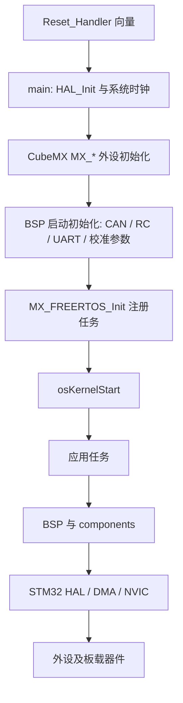
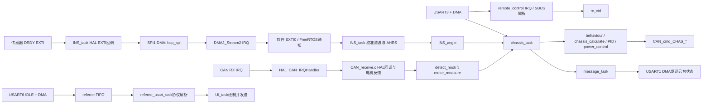

# 工程维护记录、架构与待办

本报告记录本轮配置整理、架构调用关系和待确认事项。报告按 `YYYY-MM-DD-工程待办-NN.md` 命名，同日序号递增。

## 本轮配置整理

- 当前固件唯一配置为 `Infantry_robot`、`steering_wheel`、`chassis_board`，分别定义在 [robot_param.h](../application/robot_param.h) 和 [remote_control.h](../application/remote_control.h)。Hero、Sentinel、Engineer、Balance、麦轮、全向轮及平衡轮足选项已从配置中删除。
- 保留舵轮步兵的几何尺寸、轮位、初始角、回正/跟随/小陀螺参数和速度限值；固定功率上限为步兵配置的 90 W。
- 移除只服务 Sentinel 的 RC 反序列化、30 字节串口格式和重复 `rc_ctrl` 声明；当前底盘与云台通信帧固定为 46 字节。
- 保留超级电容功能。其状态被底盘行为、电源控制和 UI 使用，并非未用车型定义。
- 配置和相关分支在 Keil ARMCC 隔离构建通过：0 错误、0 警告。
- 工作区已有 [CAN_receive.h](../application/CAN_receive.h) 的空格排版差异与本轮无关，保留未提交，不纳入本轮提交。

## 分层与归属

- **工程配置与启动**：[standard_tpye_c.ioc](../standard_tpye_c.ioc) 记录 CubeMX 外设配置；[standard_tpye_c.uvprojx](../MDK-ARM/standard_tpye_c.uvprojx) 指定 STM32F407IGHx、ARMCC 5、编译宏、包含路径及参与编译的文件。启动向量由 [startup_stm32f407xx.s](../MDK-ARM/startup_stm32f407xx.s) 提供。
- **生成的外设层**：[Src](../Src) 与 [Inc](../Inc) 中的 `main.c`、`gpio.c`、`can.c`、`dma.c`、`spi.c`、`usart.c` 等初始化 HAL 外设并提供句柄；`stm32f4xx_it.c` 将硬件向量转交 HAL IRQ handler。CubeMX 管理的文件不应直接改写其生成区外内容。
- **芯片驱动与调度中间件**：[Drivers](../Drivers) 提供 STM32F4 HAL、CMSIS 和芯片支持；[Middlewares](../Middlewares) 提供 FreeRTOS、CMSIS-RTOS 适配及 USB Device CDC 栈。FreeRTOS 调度器由 `main()` 启动，任务由 [freertos.c](../Src/freertos.c) 注册。
- **板级支持层**：[bsp/boards](../bsp/boards) 将板载 ADC、CAN、RC、SPI/DMA、USART/DMA、蜂鸣器、LED、舵机和 Flash 操作封装为 `bsp_*` 接口。它依赖生成层提供的 HAL 句柄，并由启动代码或应用任务/中断调用。
- **组件层**：[components/devices](../components/devices) 放置 BMI088、IST8310、OLED 等器件驱动；[components/algorithm](../components/algorithm) 放置 AHRS、滤波和数学算法；[components/controller](../components/controller) 提供 PID；[components/support](../components/support) 提供 FIFO、CRC、重力模型等通用支持。组件通常由应用任务调用，部分器件驱动再调用 BSP/HAL。
- **应用层**：[application](../application) 管理遥控器、IMU、底盘、检测、裁判协议、校准、射击、通信和电源控制任务及状态机；[UI](../UI) 将裁判系统、机器人和底盘状态组织成图形数据，经串口发送。

## 启动和运行链路

`main()` 中的外设初始化顺序位于 [Src/main.c](../Src/main.c)；CAN filter、RC 接收和串口发送初始化也在调度器启动前完成。当前 FreeRTOS 实际创建 message、IMU、LED、OLED、chassis、referee、servo、idle、UI 和 test 任务。`test_task` 在 [freertos.c](../Src/freertos.c) 有弱占位实现，链接时由应用层 [test_task.c](../application/test_task.c) 的强实现覆盖，用于蜂鸣器离线告警。

## 关键数据调用链

- **遥控器**：[main.c](../Src/main.c) 调用 `remote_control_init()`；它进入 [remote_control.c](../application/remote_control.c)，再调用 [bsp_rc.c](../bsp/boards/bsp_rc.c) 配置 USART3 DMA。USART3 IRQ 在应用层接收双缓冲数据，`sbus_to_rc()` 更新 `rc_ctrl`；底盘任务通过 `get_remote_control_point()` 读取。
- **IMU**：[INS_task.c](../application/INS_task.c) 初始化 BMI088/IST8310 器件驱动和 [bsp_spi.c](../bsp/boards/bsp_spi.c) 的 SPI1 DMA。EXTI 向 HAL 回调报告数据就绪；回调启动 SPI DMA，DMA2_Stream2 自定义 IRQ设置完成标志并触发软件 EXTI0，HAL GPIO 回调通知 INS 任务。任务恢复后校准、滤波并运行 AHRS，发布 `INS_angle`。
- **CAN 电机**：[bsp_can.c](../bsp/boards/bsp_can.c) 配置并启动 CAN1/2 FIFO0 通知。启动向量进入 [stm32f4xx_it.c](../Src/stm32f4xx_it.c)，HAL 再调用 [CAN_receive.c](../application/CAN_receive.c) 的接收回调更新 `motor_chas` 和离线检测。`chassis_task()` 读取反馈，经 chassis 行为、运动学、PID 和功率限制后调用 `CAN_cmd_CHAS_6020()`、`CAN_cmd_CHAS_3508()` 输出电流。
- **裁判系统**：[freertos.c](../Src/freertos.c) 创建 `referee_usart_task`；任务调用 [bsp_usart.c](../bsp/boards/bsp_usart.c) 初始化 USART6 DMA 双缓冲。`USART6_IRQHandler` 将收到的数据写入 FIFO，应用任务从 FIFO 解包，再交给 referee 数据解析；[UI.c](../UI/UI.c) 读取解析后的状态并调用 UI 图形接口。
- **底盘与云台板间通信**：[message_task.c](../application/message_task.c) 读取底盘、IMU、行为模式和机器人状态，打包后调用 USART1 DMA 发送接口；USART1 接收路径在 BSP 中解包为底盘使用的数据。当前工程只配置 chassis_board。

## 尚待确认

1. `detect_task()`、`calibrate_task()` 在应用源码中有定义，但当前 `freertos.c` 未创建对应线程；特别是错误表初始化只在 `detect_task()` 内，需确认是否有其他初始化入口及其实际运行方式，不能仅凭源码存在就假定任务运行。
2. `battery_voltage_task()` 当前未创建，但 OLED 读取其更新的电量值；确认是否应恢复调度，并上板验证 ADC 与显示。
3. `auto_aim`、gimbal 状态及相关共享模块仍被 UI/底盘代码引用；是否继续裁剪需沿实际调用和协议数据流单独确认。
4. 上板检查舵轮轮位、转向初始角、回正方向、底盘运动方向，以及 CAN/UART/DMA、裁判数据、FreeRTOS 周期和共享状态。

目标配置已由本轮 Keil 构建验证；架构报告基于 `.uvprojx` 收录、启动调用、任务创建和 IRQ/回调调用点归纳。未验证目标板实际接线和运动行为。
